# 風之草原 · Painterly Meadow

[English](README.md) | **繁體中文**

一個手繪動畫風格的自然漫遊沙盒，以 NPR（非寫實）繪本渲染呈現。
你操控一個戴著草帽的小精靈，在隨風起伏的草原上奔跑、跳躍，撐開一片樹葉從山丘上滑翔而下。一路上可以搖晃樹木收集樹枝、敲石頭、摘花，蓋起小木屋和石燈籠，親手捏出山丘與池塘，再去尋找散落在世界各處的星之碎片。

整個世界由連續的 Simplex Noise 生成：柔和的山丘、不規則的湖岸、圓潤的樹冠、雲朵和建築，**沒有任何方塊或體素**。全部內容都在單一的 `index.html` 裡，不需要建置流程。

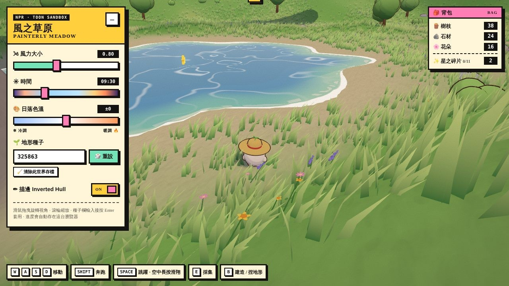

---

## 快速開始

### 直接開啟

用瀏覽器打開 `index.html` 即可。Three.js 透過 import map 從 jsDelivr CDN 載入，所以**需要連網**。

### 使用靜態伺服器（建議）

部分瀏覽器對 `file://` 有較嚴格的限制，用任一靜態伺服器會更穩定：

```bash
# Python
python3 -m http.server 8000

# 或 Node.js
npx serve .
```

然後開啟 <http://localhost:8000/>。

### 指定地形種子

在網址加上 `?seed=` 即可重現同一座世界：

```
http://localhost:8000/?seed=325863
```

- 數字會直接當作種子，其他文字（例如 `?seed=meadow`）會被雜湊成數字。
- 不指定時會隨機產生一個種子。
- 每次重建世界後，目前的種子會自動寫回網址列，複製網址就能分享同一座世界的地形。
- 背包、建築、地形修改與星之碎片的進度是**每個種子各自一份**，存在瀏覽器的 `localStorage`，分享網址不會帶上這些進度。

### 環境需求

支援 WebGL 與 ES Module（import map）的瀏覽器，例如近期版本的 Chrome、Edge、Firefox、Safari。

---

## 功能示範

**線上試玩：** https://malilion.github.io/Painterly-Meadow/

| 功能 | 示範 |
| --- | --- |
| 漫遊、奔跑、跳躍、旋轉視角 | 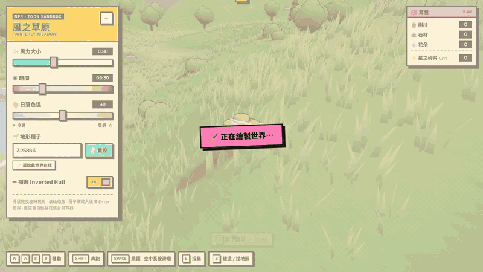 |
| 葉子滑翔 | 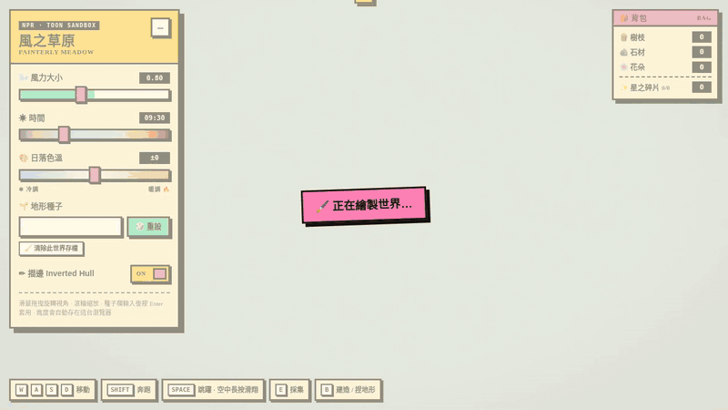 |
| 採集（樹枝／石材／花朵） | 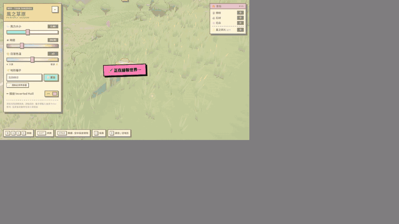 |
| 建造、旋轉、拆除 | 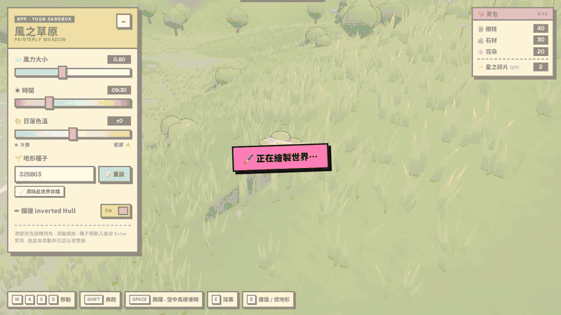 |
| 捏地形（抬升／下挖／整平） | 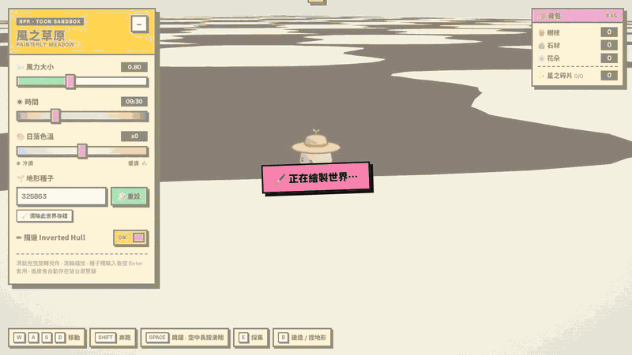 |
| 風力大小 | 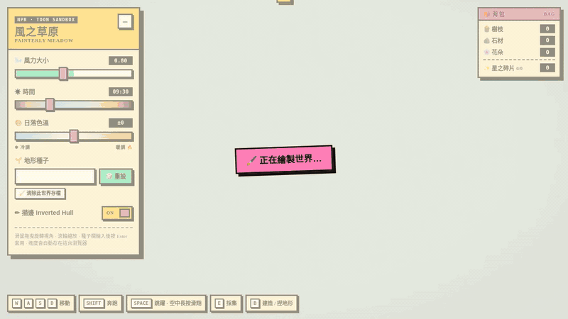 |
| 時間（日出到夜晚） | 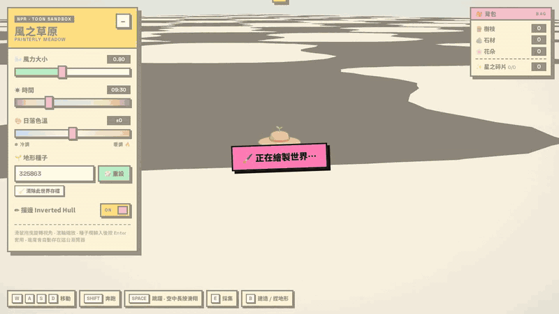 |
| 日落色溫 | 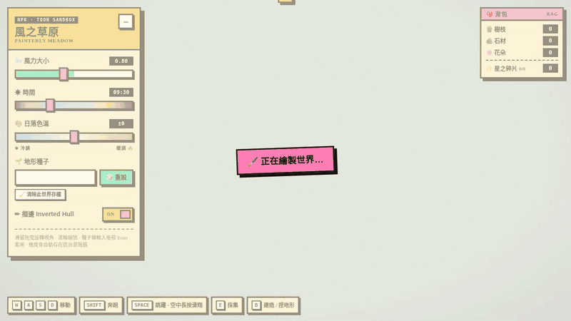 |
| Inverted Hull 描邊開關 | 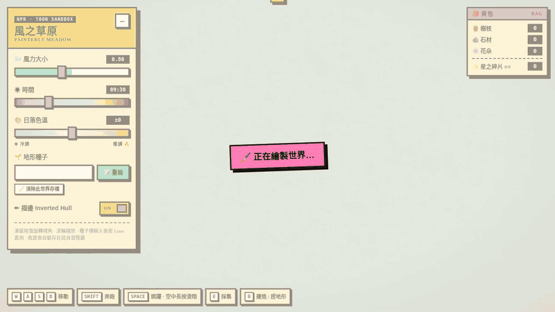 |
| 地形種子重設 | 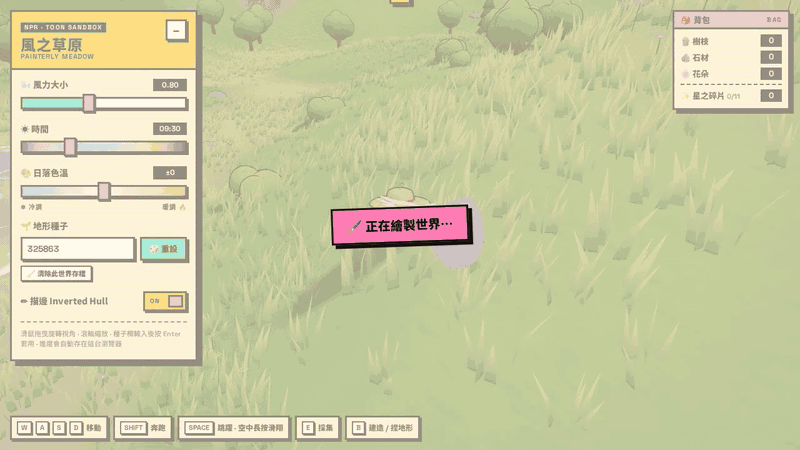 |

---

## 截圖展示

| 採集：搖晃樹木拿到樹枝 | 建造模式：綠色預覽代表可以放置 |
| --- | --- |
| 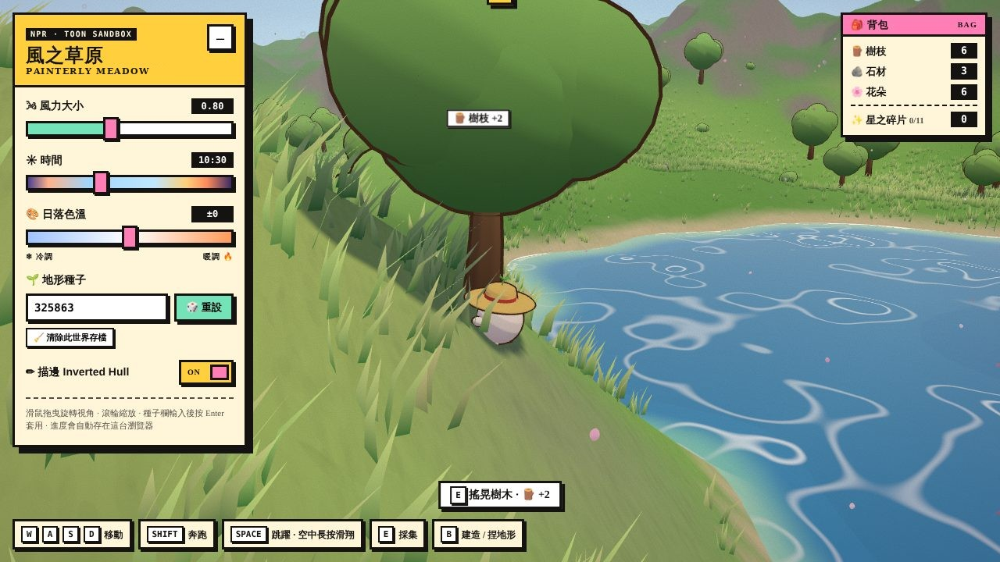 | 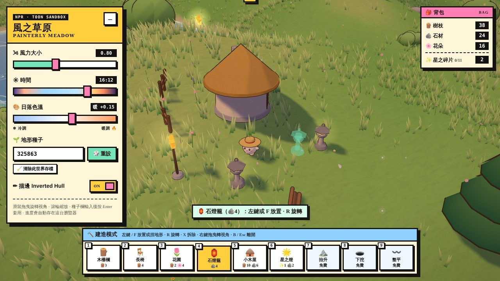 |

| 捏地形：抬升山丘、挖出池塘 | 傍晚的星之碎片 |
| --- | --- |
| 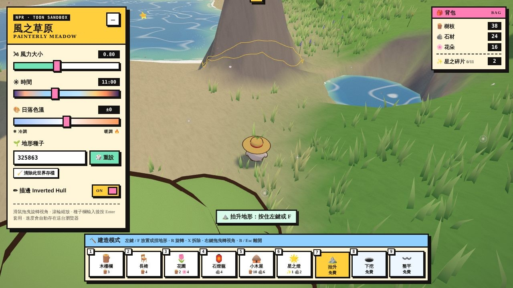 | 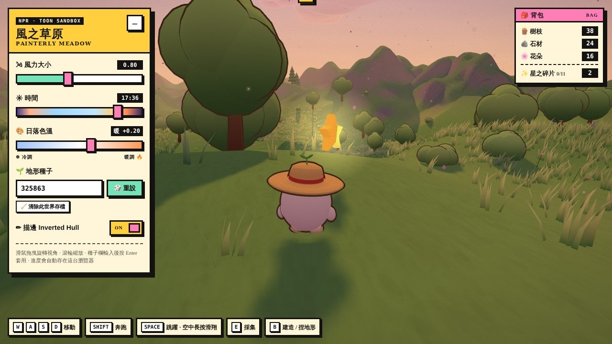 |

入夜後，石燈籠、小木屋的圓窗和星之燈會亮起來：

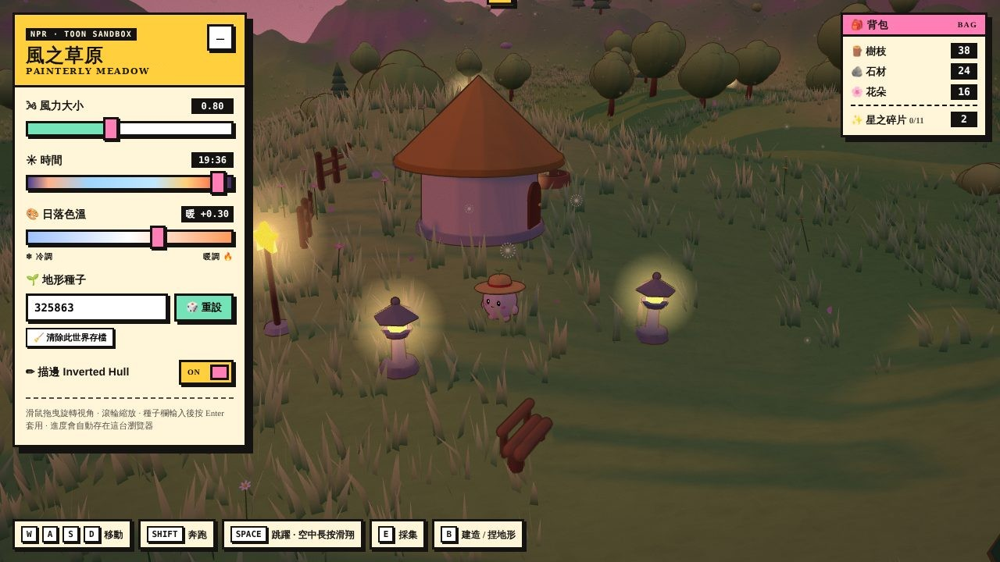

撐開樹葉從湖邊滑翔：

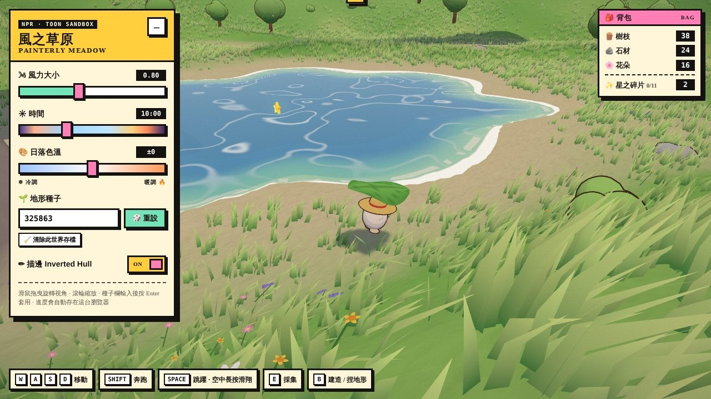

> 截圖使用種子 `325863`。

---

## 操作方式

### 移動與採集

| 按鍵 | 動作 |
| --- | --- |
| `W` `A` `S` `D` / 方向鍵 | 移動（以鏡頭方向為準） |
| `Shift` | 奔跑 |
| `Space` | 跳躍 |
| 空中按住 `Space` | 撐開樹葉滑翔 |
| `E` | 採集眼前的樹木、灌木、岩石或花朵 |
| 滑鼠拖曳 | 旋轉視角 |
| 滑鼠滾輪 | 拉近／拉遠鏡頭 |

### 建造模式

| 按鍵 | 動作 |
| --- | --- |
| `B` | 開關建造模式 |
| `1`–`9` | 選擇建築或地形工具（在一般模式按下也會直接進入建造模式） |
| 滑鼠移動 | 瞄準要放置或捏塑的地面 |
| 滑鼠左鍵點一下 / `F` | 放置建築 |
| 按住滑鼠左鍵 / 按住 `F` | 捏地形（選擇 7–9 號工具時） |
| `R` | 旋轉建築 45° |
| `X` | 拆除游標附近的建築（材料全數歸還） |
| 滑鼠右鍵拖曳 | 在捏地形時旋轉視角 |
| `Esc` | 離開建造模式 |

### 控制面板（左上角）

| 控制項 | 效果 |
| --- | --- |
| 🌬 風力大小 | 影響草叢擺動幅度、花瓣與蒲公英的飄移速度、雲的移動速度，以及滑翔時被風推送的力道 |
| ☀ 時間 | 05:30–20:00，改變太陽軌跡、天空漸層、霧色與光線顏色；天色越暗，燈籠與星星越亮 |
| 🎨 日落色溫 | 把整體光線往冷調（藍）或暖調（橙）偏移 |
| 🌱 地形種子 | 輸入種子後按 `Enter` 套用，或按「🎲 重設」隨機產生新世界 |
| 🧹 清除此世界存檔 | 把目前種子的背包、建築、地形修改與星之碎片紀錄全部重置 |
| ✏ 描邊 | 開關角色、樹木、岩石與建築的 Inverted Hull 描邊 |

面板右上角的「–」可以收合面板，右上角的背包會顯示目前的材料數量。

> 目前只支援鍵盤與滑鼠操作。觸控裝置可以拖曳旋轉視角，但無法操控角色走動或建造。

---

## 玩法

### 漫遊與滑翔

- **漫遊**：角色會平滑貼合起伏的地形，走過草叢時會把草撥開，碰到樹幹、岩石和建築會被擋住。太陡的坡爬不上去，世界外圍由環山包圍。
- **跳躍**：跳躍帶有輸入緩衝和「土狼時間」，從邊緣走出去後短時間內仍可起跳。落地時角色會有擠壓回彈的動畫。
- **葉子滑翔**：在空中下落時按住空白鍵，小精靈會舉起一片大樹葉緩緩降落，並順著風向漂移。滑翔有耐力限制（約 2.8 秒），落地後會自動回復，畫面下方的耐力條會顯示剩餘量。
- **戲水**：走進深水區時角色會浮在水面上，移動速度變慢，仍然可以跳起來。

### 採集

走近可採集的東西時，畫面下方會出現提示，按 `E` 即可採集。

| 對象 | 收穫 | 規則 |
| --- | --- | --- |
| 🌳 闊葉樹／杉樹 | 🪵 樹枝 +2 | 樹會搖晃並灑落葉子，同一棵樹 20 秒後才能再搖 |
| 🌿 灌木 | 🪵 樹枝 +1 | 12 秒後才能再撥 |
| 🪨 岩石 | 🪨 石材 +1 | 每顆可敲 3 次，敲完會縮小，60 秒後恢復 |
| 🌸 雛菊、金鳳花、波斯菊、薰衣草 | 🌸 花朵 +1 | 摘下的花 45 秒後會重新長出來 |

### 建造

按 `B` 進入建造模式後，畫面下方會出現工具列。滑鼠指到的地面會顯示建築的預覽：**綠色代表可以放置，紅色代表不行**，提示列會說明原因（太遠、在水裡、地面太陡、被樹擋住、材料不足等）。

| 編號 | 建築 | 材料 | 說明 |
| --- | --- | --- | --- |
| 1 | 木柵欄 | 🪵3 | 可以一段段接起來圍出小院子 |
| 2 | 長椅 | 🪵4 | 圓木做的長椅 |
| 3 | 花圃 | 🪵2 🌸4 | 種著會隨風搖曳的小花 |
| 4 | 石燈籠 | 🪨4 | 入夜後會亮起暖光 |
| 5 | 小木屋 | 🪵10 🪨6 | 茅草圓頂小屋，圓窗夜裡會亮 |
| 6 | 星之燈 | ✨1 🪨2 | 頂端掛著旋轉的星星，需要一顆星之碎片 |

小木屋需要比較平坦的地面，可以先用「整平」工具處理。按 `X` 拆除建築時，材料會全數歸還。

### 捏地形

建造工具列的 7–9 號是地形筆刷，不需要材料。按住滑鼠左鍵（或 `F`）塗抹，地面上的圓圈代表筆刷範圍。

| 編號 | 工具 | 效果 |
| --- | --- | --- |
| 7 | ⛰️ 抬升 | 把地面堆高成小山丘 |
| 8 | 🕳️ 下挖 | 往下挖；挖到水面以下就會變成池塘 |
| 9 | 〰️ 整平 | 以按下時的中心高度為準把地面抹平 |

地形改變後，草叢、花朵、樹木、建築和星之碎片都會重新貼合地面，地表會依新的坡度重新上色（陡坡會露出岩石），水深貼圖也會即時更新，沉入水中的草和樹會被隱藏。

### 星之碎片

每個世界大約藏著 12 顆會發光的星之碎片，走過去碰到就會收進背包：

- **山頂**：在附近最高的地方，要爬上去。
- **半空**：浮在離地約 3 公尺的地方，要跳起來或從高處滑翔過去。
- **湖面**：浮在湖泊上方，可以游過去再跳，或從岸邊滑翔。

星之碎片的光暈不受霧影響，從遠處也看得到，傍晚和夜裡會更亮。收集到的碎片可以用來建造星之燈；背包會顯示這個世界已經找到幾顆。

### 存檔

背包、建築、地形修改與已找到的星之碎片會在每次變動後自動存到瀏覽器的 `localStorage`，並以種子區分。切換種子時會先保存目前的世界，回到同一個種子就會載入原本的進度。按面板上的「🧹 清除此世界存檔」可以讓世界回到最初的樣子。

---

## 渲染技術

### 地形與湖泊

- 自行實作的可設定種子 2D Simplex Noise，以多層 fbm 疊加出連綿山丘，外圍再疊一圈環山。
- 每個種子隨機挖出 2–3 座湖泊，湖岸半徑再用噪聲擾動成不規則形狀；零碎的淺窪會被填平，水只留在湖泊裡。
- 角色的高度取樣與網格三角化使用完全相同的插值方式，所以角色不會浮空或陷進地面。
- 地表顏色由頂點色依高度、坡度與噪聲混合（草地、花田、沙岸、岩石、湖床），再疊一張 Canvas 繪製的水彩筆觸貼圖。
- 法線以有限差分計算，捏地形時只需要重算筆刷範圍內的頂點高度、法線、顏色與水深，其他系統也只更新受影響的區域。

### 繪本感 Toon 著色

- 全場景使用 `MeshToonMaterial`，搭配以 Canvas 繪製的自訂漸變貼圖（三段色階，交界處稍微柔化）。
- `HemisphereLight` 的天空色與地面色調成紫藍色，陰影因此帶有溫暖的紫藍色調，而不是死黑。
- 樹冠與雲朵的法線會朝整體中心「吹圓」，讓它們像一整團柔軟的色塊般受光。
- 燈籠、窗戶與星星共用發光材質和加法混合的光暈 sprite，亮度隨天色自動調整。

### Inverted Hull 描邊

- 在 Vertex Shader 中沿法線外擴、只渲染背面，形成深褐色的柔和描邊。
- 樹木與岩石的描邊網格直接共用本體的 `instanceMatrix`，所以搖晃動畫和縮放會同步到描邊。

### 隨風搖曳的草叢

- 數萬叢草葉與四種小花（雛菊、金鳳花、波斯菊、薰衣草）以 `InstancedMesh` 渲染，草叢分成 8×8 區塊以便視錐剔除。
- 透過 `onBeforeCompile` 改寫 Vertex Shader：在世界空間計算一波波掃過草原的風浪、細碎抖動，以及角色經過時的推草效果。
- 草葉法線朝上，讓草與地面同調受光；雙面渲染時不翻轉背面法線，避免背光面發黑。
- 摘花或被水淹沒時，只把該個實例的矩陣縮成一點，不需要重建整個 `InstancedMesh`。

### 動畫感水體

- 頂點以多組正弦波起伏。
- Fragment Shader 依風向偏移噪聲座標，畫出卡通波紋線、硬邊太陽高光與菲涅耳天空反射。
- 從地形高度烘焙一張深度貼圖，用來決定淺水與深水的顏色，以及會隨時間呼吸的岸邊泡沫；挖出新池塘時會局部重新烘焙。

### 天空、雲與粒子

- 天空是一個帶漸層、太陽光暈和水彩橫向筆刷紋理的著色器球體。
- 約 14 朵由多顆球體合併而成的立體白雲，雲底壓平，會隨風漂移並投下移動的陰影。
- 陰影相機跟隨角色移動，讓近處的陰影維持足夠的解析度。
- 花瓣使用 `InstancedMesh`，蒲公英絨毛使用 `Points` 搭配 Canvas 繪製的 sprite，兩者都會跟著風向飄落。
- 採集、建造和收集星星時，會用一組共用的 `InstancedMesh` 迸發小粒子，並以 DOM 飄字顯示收穫。

### 時間與色溫

時間軸上有七組調色盤關鍵影格（清晨、早晨、正午、午後、黃昏、日落、入夜），依時間插值天空、太陽、半球光、霧與水色，再依色溫滑塊往冷調或暖調偏移。

---

## 專案結構

```
.
├── index.html            # 完整的遊戲：HTML、CSS 與 JavaScript 都在這個檔案裡
├── README.md             # 英文說明
├── README.zh-TW.md       # 繁體中文說明
├── LICENSE
├── .github/workflows/    # GitHub Pages 部署
└── docs/
    ├── demo/             # 功能示範 GIF
    └── screenshots/      # README 使用的截圖
```

`index.html` 內的 JavaScript 依功能分成以下區塊：

| 區塊 | 內容 |
| --- | --- |
| 0. 全域設定與小工具 | 世界尺寸、狀態與背包、亂數產生器、Simplex Noise |
| 1. 繪本質感貼圖 | Toon 漸變貼圖、筆觸紋理、蒲公英 sprite、光暈與發光材質 |
| 2. 共享著色器 | 風場草叢材質、Inverted Hull 描邊材質、幾何小工具 |
| 3. 渲染器／場景／燈光／天空 | WebGLRenderer、半球光、太陽與陰影、天空球 |
| 4. 地形 | 高度場生成、湖泊、局部更新、捏地形筆刷、存檔差異 |
| 5. 水體 | 深度貼圖烘焙（可局部更新）、水面著色器 |
| 6. 植被 | 草叢與小花的生成、摘花與重生、貼合地形 |
| 7. 樹木／灌木／岩石 | 模型、採集節點、碰撞體、搖晃與恢復動畫 |
| 8. 雲 | 立體雲的生成與漂移 |
| 9. 粒子 | 花瓣與蒲公英絨毛 |
| 10. 角色 | 小精靈模型、移動控制、滑翔、碰撞與動畫 |
| 11. 互動回饋 | 迸發粒子、飄字、提示訊息 |
| 12. 星之碎片 | 擺放規則、漂浮動畫、收集判定 |
| 13. 建造與捏地形 | 建築模型、建造工具列、預覽與放置、地形同步、碰撞、採集、存檔 |
| 14. 環境 | 時間調色盤、色溫與夜間發光 |
| 15. 鏡頭／輸入 | 第三人稱鏡頭、鍵盤與滑鼠 |
| 16. 世界生成 | 依種子重建整個世界並載入存檔 |
| 17. UI 綁定 | 控制面板事件 |
| 18. 主迴圈 | 每幀更新與渲染 |

### 依賴

- [Three.js](https://threejs.org/) r160（含 `BufferGeometryUtils`），透過 CDN 載入
- Google Fonts：Space Grotesk、Noto Sans TC（無法載入時會改用系統字型）


## 授權

本專案以 [MIT License](LICENSE) 釋出。
